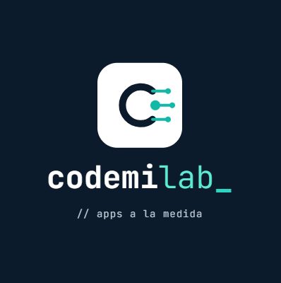

# codemi**lab\_**

### Software a la medida. Del problema a la solución.

---

## 🎯 Qué hago

Convierto problemas operativos en **aplicaciones que funcionan**. Si hoy tu negocio depende de hojas de Excel, papeles, mensajes sueltos o procesos manuales, lo transformo en una herramienta clara, rápida y fácil de usar para tu equipo.

No vendo software genérico: **cada solución se construye a partir de cómo trabajas tú**.

## 🧰 Soluciones

- **Sistemas de registro y control**: inventarios, bitácoras, checklists, mantenimiento, asistencia.
- **Paneles y reportes**: tus datos convertidos en información lista para decidir.
- **Herramientas internas** que reemplazan procesos manuales y repetitivos.
- **Formularios, cotizadores y portales** para atender a tus clientes.
- **Sitios web** profesionales para presentar tu negocio.

## 🧭 Cómo trabajo

1. **Entiendo el problema.** Antes de escribir una línea de código, converso contigo y reviso cómo se hace hoy el proceso.
2. **Defino el alcance.** Acordamos qué se va a entregar, en cuánto tiempo y a qué costo, sin sorpresas.
3. **Construyo por etapas.** Ves avances reales y puedes ajustar sobre la marcha.
4. **Entrego y acompaño.** Pruebo, publico y te explico cómo usarlo.

## 💪 Mi respaldo

- Años de experiencia en **operación, redes y soporte de tecnología** en entornos donde las fallas cuestan dinero y el tiempo importa.
- Formación orientada a **resolver problemas reales**, no a lucir tecnología.
- **Aprendo rápido**: si tu proyecto requiere una herramienta nueva, la domino, porque mi trabajo es resolver tu necesidad.

## 🤝 Mi compromiso

- Comunicación clara y respuestas a tiempo.
- Código ordenado, versionado y respaldado.
- Tus datos y los de tu negocio, tratados con **confidencialidad**.
- Si algo no es viable, te lo digo desde el inicio.

## 🛠️ Tecnologías

**Desarrollo web**

**Herramientas y publicación**

**Infraestructura y TI (mi base profesional)**

**En el radar (lo que estoy incorporando)**

## 🚀 Proyectos

- [hola-codemi](https://codemilab.github.io/hola-codemi/): primera página publicada.
- _Nuevas demos próximamente._

## 📬 Hablemos de tu proyecto

Cuéntame qué necesitas resolver y te respondo con una propuesta clara.

- 📧 [codemi.lab@gmail.com](mailto:codemi.lab@gmail.com)
- 💬 [WhatsApp](https://wa.me/50232917334)

---

Codemi Lab · Software a la medida
